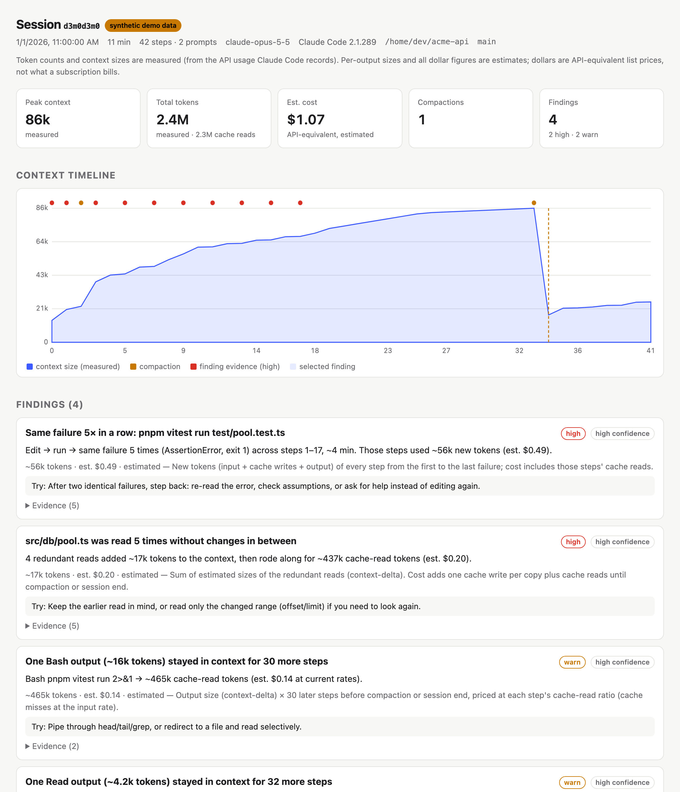

# Tailspin

**A flight recorder for Claude Code sessions.** It reads your local session transcripts and shows *why*
a session burned tokens: retry loops, redundant file reads, and tool outputs that sat in the context for
dozens of steps, with what each one cost.



```sh
npx agent-tailspin            # latest session in the current directory
npx agent-tailspin --demo     # try it on a bundled synthetic session
```

**Fully local.** No network requests, no telemetry, no accounts. It reads `~/.claude/projects` and writes
one HTML file to your temp directory. To check: the package has zero runtime dependencies, the source
has no network code (`grep -rn "fetch\|http" src` finds only the SVG namespace string, the CSP tag, and a
"nothing is fetched" notice), and every report ships with a
`Content-Security-Policy: default-src 'none'` meta tag, so even the report page can't make a request.

## What it finds

| Detector | Fires when | Example |
|---|---|---|
| **failure-loops** | The same action fails with the same normalized error ≥ 3 times, with edits (or identical retries) between attempts and no progress | "Same failure 5× in a row: `pnpm vitest run test/pool.test.ts`" |
| **repeated-reads** | A file range is read again with no edit, file-changing command, external edit, subagent run, or compaction in between | "`src/db/pool.ts` was read 5 times without changes in between" |
| **output-lifetime** | One tool output ≥ 4k tokens rode along in the context for ≥ 100k cache-read tokens | "One Bash output (~16k tokens) stayed in context for 30 more steps" |

Every finding links to the exact steps on the context timeline, states its confidence, and says how its
impact was computed. Precise definitions, guards, and known limitations: [docs/detectors.md](docs/detectors.md).

**Measured vs estimated.** Step token usage, context size, and totals are measured (they come from the API
usage Claude Code records). The size of an individual tool output is estimated, from the context growth
between steps where that's unambiguous and from character count otherwise. Dollar figures are
API-equivalent list prices, not what a subscription plan bills. The report labels every number.

There is deliberately no single "wasted tokens" total: findings overlap, so a sum would be misleading.

## Commands

```
agent-tailspin                          analyze the latest session for the current directory
agent-tailspin list [--since 7d] [--project <path>] [--limit N]
agent-tailspin analyze <session-id|path> [options]
agent-tailspin --demo
```

| Option | |
|---|---|
| `--redact` | share-safe report (below) |
| `--out <file>` | HTML path (default: `$TMPDIR/agent-tailspin/report-<id>.html`) |
| `--no-open` | don't open a browser |
| `--json` | findings and metrics as JSON ([schema](docs/json-schema.md)), no HTML |
| `--pricing <file>` | override the bundled pricing table |
| `--min-confidence low\|medium\|high` | default `medium` |
| `--verbose` | show parse warnings |

Exit codes: `0` success (including zero findings), `1` unexpected error, `2` bad usage or no sessions.

## Sharing a report: `--redact`

Redaction happens in the data model before anything is written, not by hiding things in the page.

**Removed:** your prompts, assistant text, tool inputs (commands, patterns, file contents, diffs), tool
outputs, error messages, the working directory, and the git branch. File paths become stable tokens
like `file_01.ts`, keeping the extension, so you can still see that one file was read five times.
Error types are shown only when they're generic built-ins (`TypeError`, `AssertionError`, …).

**Still visible:** timestamps, token counts, context sizes, tool names, step numbers, model names, the
session id, and the finding structure. That means **your tool-usage pattern and session size stay visible**.
Don't share a redacted report if those are sensitive.

A test seeds a session with fake secrets (an API key, a home path, an email, an internal hostname) and
asserts none of them appear in redacted HTML or JSON output.

## Precision

Tailspin is built to be wrong rarely: when a detector isn't sure, it stays quiet or marks the finding
low-confidence and hides it by default. Precision is measured from hand labels (`npm run eval`).

| Detector | Real sessions labeled | Precision (real) | Synthetic fixtures |
|---|---|---|---|
| failure-loops | 0 | not measured yet | 4/4 |
| repeated-reads | 0 | not measured yet | 3/3 |
| output-lifetime | 0 | not measured yet | 3/3 |

Synthetic numbers only show the fixtures behave as designed; they say nothing about real-world precision.
Real-session numbers come from the maintainer labeling their own sessions (labels stay private; only
aggregates are published). A release is blocked if any detector falls below 80%. Each detector also has
false-positive fixtures that must stay quiet (edits between reads, compaction, polling loops, changing
errors, and others; see `fixtures/synthetic/catalog.ts`).

To label your own: `npm run eval -- --template <session-id> > eval/labels/private/<name>.json`, set each
`label` to `TP`, `FP`, or `unclear`, then run `npm run eval`.

## What it doesn't do

- It isn't a spend dashboard; use [ccusage](https://github.com/ryoppippi/ccusage) for that.
  Totals count each API request once. Against Claude Code's own cost tally on local sessions: sessions
  without subagents matched within 0–5% (one to the cent); the two with subagents came out 13–15% lower.
  That gap closes almost exactly if every streamed line of a subagent response is counted separately,
  even though those lines share one request id. So Claude Code's tally appears to add up repeated
  snapshots of the same request. This is an inference from the numbers, not confirmed billing behavior.
- No LLM calls. Analysis is deterministic: the same transcript gives the same report.
- It never edits your config or `CLAUDE.md`.
- Claude Code only, for now. Subagent tokens are counted in totals, but detectors don't run on subagents yet.

**The transcript format is unofficial.** Claude Code's JSONL format isn't a documented API and changes
between versions. Tailspin parses defensively (unknown lines become warnings, never crashes) and was
built against Claude Code 2.1.27x–2.1.28x ([format notes](docs/format-notes.md)). If a new version
breaks something, please open an issue with the output of `--verbose`. Never attach a real transcript.

## Development

```sh
npm install
npm test            # vitest: parser, detectors, redaction, report safety, CLI
npm run lint        # eslint, incl. the no-Node-APIs rule for isomorphic code
npm run typecheck
npm run build       # dist/cli.js (single file, zero runtime deps)
npm run fixtures    # regenerate synthetic fixtures, demo, and synthetic labels
npm run eval        # precision table from labels
```

Read [PRODUCT.md](PRODUCT.md) for scope and [docs/decisions.md](docs/decisions.md) for deviations.
All fixtures are synthetic, built with the DSL in `fixtures/builder/`. Never commit real transcripts.

## License

MIT
